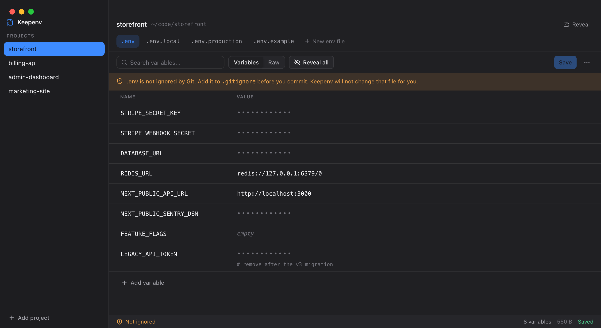
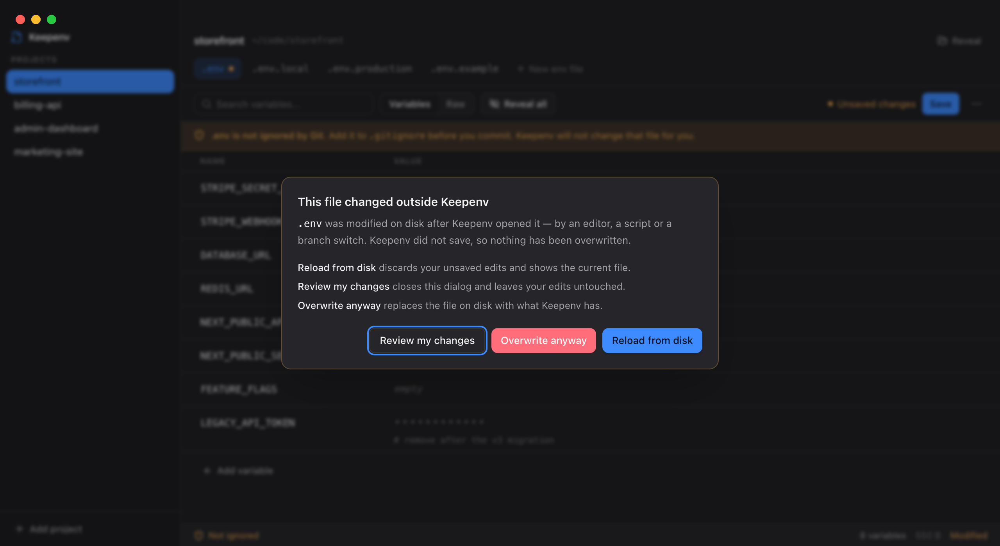

<div align="center">

# Keepenv

**Manage your projects' `.env` files without mangling them.**

A local-only macOS app for editing environment files in place. Every comment,
blank line, quote style and column of alignment survives your edits.
No account, no cloud, no telemetry, no network.

[](https://github.com/peter-palmer/keepenv/actions/workflows/ci.yml)
[](LICENSE)
[](#install)
[](https://tauri.app)



</div>

---

## Why this exists

Every GUI that touches a `.env` file eventually does the same thing: it parses
your file into a key–value object and writes it back out as `KEY=value`. Your
section comments, your deliberate blank lines, your carefully aligned columns,
the single quotes you used on that one connection string — all normalised away
the first time you change a port number.

Keepenv never does that. It edits the line you asked it to edit and leaves
every other byte alone.

```diff
  # ─── Database ────────────────────────────────────────
- DATABASE_URL='postgres://app@localhost:5432/app_dev'   # primary
+ DATABASE_URL='postgres://app@localhost:5432/app_prod'  # primary
  REDIS_URL=redis://127.0.0.1:6379/0
```

One line changed. The comment, the quote style and the trailing alignment are
exactly as you left them. That is the whole product.

## Your secrets stay put

Keepenv is a window onto your `.env` files, not a place to put them. It has no
account system, no backend, no sync, and makes **zero network requests** — CI
fails the build if a single `fetch` reaches the bundle.

It also never copies your values into its own storage. That isn't a promise,
it's the shape of the code: the only thing Keepenv persists is this.

```json
{
  "version": 1,
  "projects": [
    { "id": "…", "name": "storefront", "rootPath": "/Users/you/code/storefront",
      "addedAt": "…", "order": 0 }
  ],
  "preferences": { "theme": "system", "lastProjectId": "…" }
}
```

The Rust commands that write to storage accept only `Project` and
`Preferences` — closed structs of scalar fields with no free-form map. There is
no API the interface could call to persist a variable name or a value, even by
accident. A test asserts it against a real binary and a planted canary secret.

Your `.env` file remains the only source of truth. Keepenv reads it from disk,
shows it, and writes back to the same file.

## Features

- **Lossless editing.** Comments, blank lines, ordering, quoting, `export`
  prefixes, indentation and inline comments all survive.
- **Every project in one sidebar.** Add a folder, reorder by dragging, rename,
  reveal in Finder. Removing a project forgets it — nothing on disk is touched.
- **All your environments as tabs.** `.env`, `.env.local`, `.env.production`
  and friends, sorted sensibly rather than alphabetically.
- **Values hidden by default**, revealed one at a time, with a `Reveal all`
  that visibly announces itself.
- **Structured and raw views** that cannot drift apart — both read from the
  same text.
- **Git awareness.** Keepenv tells you when a secrets file is exposed to Git.
  It never edits `.gitignore` and never commits.
- **It won't clobber a file that changed underneath you.** Save compares a
  fingerprint of the bytes on disk and stops if something else got there first.
- **Deleting is reversible.** Removing a variable is undoable; deleting a file
  moves it to the Trash and always asks first.
- **`keepenv .` from the terminal**, the way you'd open an editor. Switches the
  open window instead of spawning a second one.

<div align="center">

<br><em>A save that would have overwritten someone else's change.</em>
</div>

## Install

### Download

Grab the `.dmg` from [Releases](https://github.com/peter-palmer/keepenv/releases),
open it, and drag Keepenv to Applications. Universal binary — Apple Silicon and
Intel.

> [!IMPORTANT]
> Keepenv is **not code-signed or notarised yet**, because that needs a paid
> Apple Developer account. On first launch, right-click the app and choose
> **Open**, then confirm. macOS remembers the choice. If it claims the app
> "is damaged", clear the quarantine flag:
> ```bash
> xattr -dr com.apple.quarantine /Applications/Keepenv.app
> ```
> If that trade-off isn't acceptable, build from source — it takes two minutes.

### Build from source

Needs Node 20+, Rust (stable) and Xcode Command Line Tools.

```bash
git clone https://github.com/peter-palmer/keepenv.git
cd keepenv
npm install
npm run tauri build
```

The app lands in `src-tauri/target/release/bundle/macos/Keepenv.app`.

### Open projects from the terminal

Like `code .` or `windsurf .`:

```bash
./scripts/install-cli.sh
```

Then, from any project folder:

```bash
keepenv .          # open this folder
keepenv ../api     # or a relative one
keepenv /abs/path  # or an absolute one
keepenv            # just open Keepenv
```

The folder is added as a project if it isn't one already, and selected. Run it
again in the same folder and you get the existing project — no duplicates. If
Keepenv is already open it switches the current window rather than opening a
second one, and the shell prompt returns immediately either way.

The installer picks the first directory on your `PATH` that you own, trying
`/usr/local/bin`, `/opt/homebrew/bin` and `~/.local/bin` in that order, so it
never needs `sudo`. Override it with `KEEPENV_BIN_DIR=... ./scripts/install-cli.sh`.
The wrapper also ships inside the app bundle, so this works from a `.dmg`
install too — and uninstalling is deleting the one file the installer names.

## How the lossless part works

The file is parsed into a list of nodes, each holding its **exact original
source text** and its own line terminator:

```ts
type EnvNode =
  | { kind: "variable"; key; value; quote; prefix; separator; suffix; multiline; raw; eol }
  | { kind: "comment";  raw; eol }
  | { kind: "blank";    raw; eol }
  | { kind: "unknown";  raw; eol };
```

Serialization is just `nodes.map(n => n.raw + n.eol).join("")`, so
`serialize(parse(text)) === text` holds for **every** input — mixed CRLF/LF,
no trailing newline, a BOM, even syntax Keepenv doesn't understand (those
become `unknown` nodes and are never rewritten).

Editing a variable recomputes `raw` for that **one node**, from
`prefix + key + separator + encodedValue + suffix`. Quoting is only ever
*upgraded*, and only when leaving it alone would change the meaning — the value
gains whitespace, a `#`, a newline, or a leading quote character.

Multi-line quoted values (PEM keys) are handled as a single node.

### One deliberate surprise

In an **unquoted** value, `#` starts a comment wherever it appears. That's
`dotenv`'s rule, which means it's what Node, Vite and Next.js actually do — so
`COLOR=#ff0000` really does reach your app as an empty string. Keepenv shows
you the truth rather than a value your app will never receive. Edit it and
Keepenv quotes it for you, which fixes it.

## Security model

The interface layer is treated as untrusted and given no filesystem primitive
at all.

| Concern | How it's handled |
| --- | --- |
| Path traversal | The webview never names a path. It passes a project id and a file name that must match the `.env` family with no separators and no `..`. One chokepoint: `src-tauri/src/paths.rs`. |
| Filesystem reach | No `tauri-plugin-fs`. Only typed commands in `src-tauri/src/commands/`. |
| Command execution | No `tauri-plugin-shell`. `git` runs from Rust with a fixed argument vector. |
| Exfiltration | Strict CSP, no remote origins, no HTTP client in the dependency tree. `opener` is called from Rust so the webview never gets `open-url`. |
| Logging | No value is ever logged. Rust errors name files, never contents. |
| Autofill & spellcheck | Every field carrying a value is opted out of both, and out of password managers. |
| Window title | Static. |

The window is granted exactly four permissions: `core:default`,
`core:window:allow-start-dragging`, `core:window:allow-destroy`,
`dialog:allow-open`.

Found a hole? See [SECURITY.md](SECURITY.md).

## Keyboard shortcuts

| Shortcut | Action |
| --- | --- |
| <kbd>⌘</kbd><kbd>S</kbd> | Save |
| <kbd>⌘</kbd><kbd>F</kbd> | Search variables |
| <kbd>⌘</kbd><kbd>N</kbd> | Add variable |

## FAQ

**How is this different from a secrets vault?**
A vault moves your secrets somewhere else and injects them at runtime. Keepenv
leaves them exactly where your tooling already expects them and just gives you
a decent way to read and edit them. If you want your secrets out of your repo
directory entirely, you want a vault, not this.

**Does it encrypt my `.env` files?**
No, deliberately. Your applications need to read them. An encrypted copy would
either be useless or would mean Keepenv holds a second copy of your secrets —
which is the one thing it refuses to do.

**Will it work on Windows or Linux?**
Nothing in the architecture prevents it — the dependencies are all
cross-platform and the shortcuts already accept <kbd>Ctrl</kbd>. It's just not
built or tested there yet. PRs welcome.

**Does it search subdirectories for `.env` files?**
Not in v1. It scans the project root only, which means `node_modules` is never
walked. Monorepo support is a reasonable future feature.

**Is it safe to edit a `.env` that's a symlink?**
Yes. Writes resolve the link and replace the target atomically, so the symlink
survives.

## Development

```bash
npm install
npm run tauri dev      # run the app
npm run check          # typecheck + tests + clippy + cargo test
```

The `.env` parser is the most sensitive part of the codebase and carries the
most coverage: quoting in every style, multi-line values, values containing
`=`, `#`, URLs and JSON, inline comments, duplicate keys, malformed and
unterminated lines, CRLF and mixed endings, BOMs, a losslessness property test
over a corpus, and an end-to-end test that edits a real file on disk and
asserts exactly one line changed.

```
src/
  lib/env/     parse · serialize · edit · quoting · validate · sort  (pure)
  services/    the only modules that import @tauri-apps/*
  state/       hooks: projects · envFiles · editor · git · theme · shortcuts
  components/  ui · layout · projects · envfiles · editor · common
src-tauri/src/
  paths.rs     filename validation and containment — the security chokepoint
  store.rs     metadata-only JSON store, atomic writes
  env_files.rs discovery · read · write · trash
  git.rs       read-only status
  commands/    the complete IPC surface
```

Contributions welcome — see [CONTRIBUTING.md](CONTRIBUTING.md). The most
valuable issue you can file is a `.env` file that Keepenv changes when it
shouldn't.

## License

[MIT](LICENSE) © Peter Palmer
